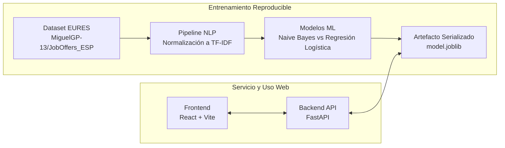

# Clasificador Inteligente de Ofertas Laborales (JobScope AI)

Sistema integral de Machine Learning y Procesamiento del Lenguaje Natural (NLP) para la clasificación automática de ofertas de empleo en español por sector profesional.

Desarrollado como Proyecto Integrador para la materia **Tópicos y Programación Avanzada**.

---

## 🎯 Problema de Negocio

Portales de empleo y áreas de Recursos Humanos reciben cientos de ofertas laborales redactadas en texto libre sin categorización estandarizada. Este sistema procesa la descripción textual de la vacante mediante un pipeline de NLP y predice con alta precisión a qué sector profesional pertenece, facilitando su enrutamiento y catalogación automática.

### Sectores Clasificados (5 Clases Principales)
1. 🚚 **Transporte y Logística:** Conductores, repartidores, mozos de almacén.
2. 🍕 **Hostelería y Gastronomía:** Cocineros, camareros, pizzeros.
3. 💼 **Ventas y Comercial:** Asesores de venta, agentes comerciales, teleoperadores.
4. 🩺 **Salud y Servicios Sociales:** Cuidadores, enfermeros, educadores.
5. 🛠️ **Construcción y Mantenimiento:** Albañiles, fontaneros, electricistas.

---

## 🏗️ Arquitectura y Tecnologías

El sistema sigue una arquitectura desacoplada en 5 capas:



* **Dataset:** [`MiguelGP-13/JobOffers_ESP`](https://huggingface.co/datasets/MiguelGP-13/JobOffers_ESP) (Red EURES España/Europa, 2025).
* **NLP & Modelado:** Scikit-Learn, spaCy (`es_core_news_sm`), NLTK, TF-IDF con sublinear scaling.
* **Backend:** FastAPI + Uvicorn + Pydantic v2 (patrón `lifespan` para carga única del modelo).
* **Frontend:** React 18 + Vite + Vanilla CSS moderno (tokens semánticos).
* **Contenedores:** Docker & Docker Compose para ejecución unificada y reproducible.

---

## 📁 Estructura del Proyecto

```text
jefofcaz_clasificador_empleos/
├── data/
│   ├── raw/             # Dataset original inmutable (EURES)
│   └── processed/       # Dataset preparado y agrupado por sector
├── notebooks/           # Análisis exploratorio (EDA) y experimentos
├── src/
│   ├── nlp/             # Preprocesamiento y transformador Scikit-Learn
│   ├── models/          # Entrenamiento, comparación y métricas
│   └── pipeline.py      # Script único de entrenamiento reproducible
├── api/                 # Backend FastAPI (schemas, service, main)
├── frontend/            # Interfaz de usuario (React + Vite)
├── artifacts/           # model.joblib y metrics.json generados
├── tests/               # Pruebas automatizadas con pytest
├── docs/                # Informe técnico y notas de diseño
├── params.yaml          # Parámetros centrales del pipeline
├── Dockerfile           # Imagen Docker base para backend/trainer
├── docker-compose.yml   # Orquestación de servicios (API, Frontend, DB)
└── requirements.txt     # Dependencias fijadas con versiones exactas
```

---

## 🚀 Despliegue Rápido con Docker

```bash
# Construir y levantar todos los servicios
docker compose up --build
```

Una vez iniciado:
* **Frontend:** `http://localhost:8080` (o `http://localhost:5173` en modo dev)
* **Backend API:** `http://localhost:8000`
* **Swagger Docs:** `http://localhost:8000/docs`
