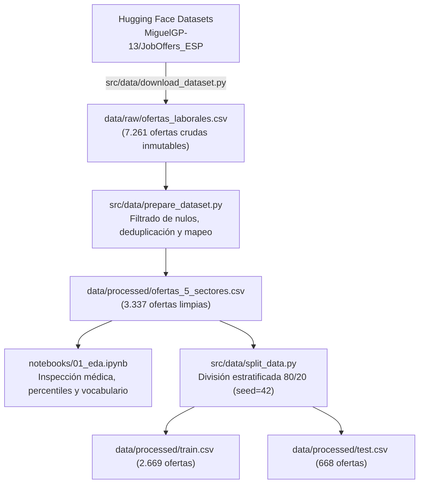

# 📊 Fase 1: Obtención del Dataset y Análisis Exploratorio (EDA)

> [!info] Objetivo de la Fase 1
> Descargar el dataset real de ofertas laborales en español ([`MiguelGP-13/JobOffers_ESP`](https://huggingface.co/datasets/MiguelGP-13/JobOffers_ESP)), limpiarlo de forma reproducible, agrupar las ocupaciones en los **5 sectores clave**, analizar sus estadísticas lingüísticas y particionarlo en conjuntos de entrenamiento (`train`) y prueba (`test`) **sin fuga de información (*data leakage*)**.

---

## 1. El Flujo de Trabajo de la Fase 1



---

## 2. Los 4 Pasos Técnicos Implementados

### Paso 1.1: Descarga Automatizada (`src/data/download_dataset.py`) - ✅ COMPLETADO
* **¿Qué se hizo?** Conexión con Hugging Face (`MiguelGP-13/JobOffers_ESP`), descarga del Parquet original y conversión a CSV crudo.
* **Resultado Real:**
  * Archivo generado: [`data/raw/ofertas_laborales.csv`](file:///e:/desarrollador/topicos/jefofcaz_clasificador_empleos/data/raw/ofertas_laborales.csv) (5.64 MB).
  * Volumen: **7.261 registros reales de EURES 2025**.
  * Columnas: `['id', 'timestamp', 'titulo', 'ocupacion', 'descripcion', 'provincia', 'tipo_contrato']`.
* **Comando:**
  ```powershell
  .venv\Scripts\python.exe -m src.data.download_dataset
  ```

---

### Paso 1.2: Filtrado, Limpieza y Mapeo a los 5 Sectores (`src/data/prepare_dataset.py`) - ✅ COMPLETADO
* **¿Qué se hizo?** Filtrado de nulos, eliminación de ofertas repetidas pre-split y mapeo jerárquico a 5 sectores.
* **Detalle completo con ejemplos:** Ver [[Fase_1_Dataset_y_EDA/02_Fase_1_Limpieza_y_Mapeo_5_Sectores|02. Limpieza y Mapeo a 5 Sectores]].
* **Resultado Real:** Generó [`data/processed/ofertas_5_sectores.csv`](file:///e:/desarrollador/topicos/jefofcaz_clasificador_empleos/data/processed/ofertas_5_sectores.csv) con **3.337 registros 100% limpios**.

---

### Paso 1.3: Notebook de Análisis Exploratorio (`notebooks/01_eda.ipynb`) - ✅ COMPLETADO
* **¿Qué se hizo?** Análisis interactivo de clases, longitudes de texto, aserciones de integridad y términos frecuentes.
* **Detalle completo con ejemplos:** Ver [[Fase_1_Dataset_y_EDA/03_Fase_1_Analisis_Exploratorio_EDA|03. Análisis Exploratorio de Datos (EDA)]].
* **Hallazgos:** Justificación de F1-Score Macro y contrato de la API `[15, 5000]` caracteres (HTTP 422).

---

### Paso 1.4: División Estratificada sin Fuga de Datos (`src/data/split_data.py`) - ✅ COMPLETADO
* **¿Qué se hizo?** Partición 80% train / 20% test con preservación de proporciones exactas de los 5 sectores.
* **Detalle completo con ejemplos:** Ver [[Fase_1_Dataset_y_EDA/04_Fase_1_Particion_Estratificada_Train_Test|04. Partición Estratificada Train/Test]].
* **Resultado Real:**
  - `data/processed/train.csv`: **2.669 ofertas (80%)**.
  - `data/processed/test.csv`: **668 ofertas (20%)**.
  - 19 pruebas de `pytest` pasando en verde.
