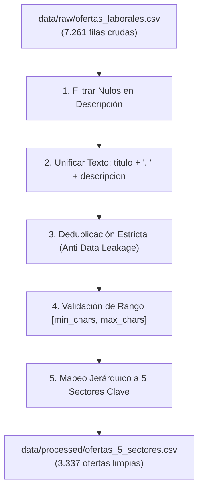

# 🧹 Paso 1.2: Filtrado, Limpieza y Mapeo a 5 Sectores Clave

> [!info] ¿Qué se construyó en este paso?
> Se implementó el módulo [`src/data/prepare_dataset.py`](file:///e:/desarrollador/topicos/jefofcaz_clasificador_empleos/src/data/prepare_dataset.py) y su suite de pruebas automatizadas [`tests/test_prepare_dataset.py`](file:///e:/desarrollador/topicos/jefofcaz_clasificador_empleos/tests/test_prepare_dataset.py).
> 
> Transforma el dataset crudo inmutable ([`data/raw/ofertas_laborales.csv`](file:///e:/desarrollador/topicos/jefofcaz_clasificador_empleos/data/raw/ofertas_laborales.csv)) en un dataset limpio, curado y categorizado ([`data/processed/ofertas_5_sectores.csv`](file:///e:/desarrollador/topicos/jefofcaz_clasificador_empleos/data/processed/ofertas_5_sectores.csv)), listo para el EDA y el entrenamiento.

---

## 1. El Problema y la Justificación Técnica (El "Por Qué")

En el dataset crudo de EURES (7.261 ofertas) encontramos 3 problemas críticos que romperían el modelo y la defensa oral:

1. **Dispersión de Clases (~300 oficios):** La columna `ocupacion` tiene puestos como *"pizzero"*, *"chofer de góndola"*, *"corredor de seguros"*. Clasificar 300 oficios daría un F1-Score bajísimo (<20%) y una **matriz de confusión gigante de $300 \times 300$** imposible de renderizar en React.
2. **Duplicados y Fuga de Datos (*Data Leakage*):** Hay convocatorias de empleo publicadas repetidas veces por diferentes agencias. Si no se eliminan antes del split, una copia entrará a `train` y otra a `test`, haciendo trampa en la evaluación.
3. **Textos Nulos o Inválidos:** Ofertas sin descripción o con longitud de 2 caracteres que provocarían excepciones `AttributeError` o divisiones por cero en el vectorizador TF-IDF.



---

## 2. Los 5 Sectores Profesionales Oficiales

Definidos en [`params.yaml`](file:///e:/desarrollador/topicos/jefofcaz_clasificador_empleos/params.yaml) y respaldados por la taxonomía EURES/ESCO:

| Sector | Identificador | Palabras Clave Principales |
|---|---|---|
| 🚚 **Transporte y Logística** | `transporte_logistica` | conductor, chofer, camionero, repartidor, mozo de almacén, carretillero, logística, furgoneta |
| 🍕 **Hostelería y Gastronomía** | `hosteleria_gastronomia` | camarero, cocinero, chef, pizzero, barista, planchista, ayudante de cocina, buffet, restaurante |
| 💼 **Ventas y Comercial** | `ventas_comercial` | agente comercial, vendedor, dependiente, seguros, teleoperador, cajero de supermercado, prospección |
| 🩺 **Salud y Servicios Sociales** | `salud_servicios_sociales` | enfermero, médico, auxiliar de enfermería, educador social, trabajador social, cuidador, gerocultor, centro de día |
| 🛠️ **Construcción y Mantenimiento** | `construccion_mantenimiento` | electricista, mecánico, fontanero, albañil, carpintero, pintor de obra, soldador, encofrador, climatización |

---

## 3. Ejemplos Prácticos: ¿Cómo se Procesa una Oferta Real?

A continuación se muestran ejemplos paso a paso con datos reales del dataset:

### 🌟 Ejemplo 1: Oferta de Transporte (Mapeo por `ocupacion`)
* **Entrada Cruda:**
  - `ocupacion`: `"Conductor de camión"`
  - `titulo`: `"TRANSPORTE INTERNACIONAL DE MERCANCÍAS"`
  - `descripcion`: `"Empresa líder busca chofer con carnet C+E y CAP en vigor para rutas nocturnas. 2 años de experiencia."`
* **Paso 1 (Texto unificado):** `"TRANSPORTE INTERNACIONAL DE MERCANCÍAS. Empresa líder busca chofer con carnet C+E..."`
* **Paso 2 (Normalización):** Se quitan tildes y mayúsculas $\rightarrow$ `"conductor de camion"` coincide con la lista de palabras clave de transporte.
* **Resultado:** Clasificada en `transporte_logistica`.

### 🌟 Ejemplo 2: Oferta de Hostelería (Mapeo por `titulo` ante ocupación genérica)
* **Entrada Cruda:**
  - `ocupacion`: `"Personal de servicios"` *(genérico)*
  - `titulo`: `"Ayudante de cocina para restaurante italiano"`
  - `descripcion`: `"Preparación de ingredientes, apoyo a cocina y limpieza de partidas."`
* **Diagnóstico:** Como `ocupacion` es genérica, el algoritmo salta a inspeccionar el `titulo`.
* **Resultado:** Coincide con *"cocina"* y *"restaurante"* $\rightarrow$ Clasificada en `hosteleria_gastronomia`.

### 🌟 Ejemplo 3: Oferta Descartada (Fuera de los 5 sectores)
* **Entrada Cruda:**
  - `ocupacion`: `"Diseñador gráfico"`
  - `titulo`: `"Diseñador UI/UX y maquetación web"`
  - `descripcion`: `"Manejo de Figma, Photoshop e Illustrator para branding corporativo."`
* **Diagnóstico:** No coincide con ninguna palabra clave de los 5 sectores seleccionados.
* **Resultado:** Retorna `None` y se descarta del dataset final para no contaminar las 5 clases.

### 🌟 Ejemplo 4: Oferta Duplicada (Anti Data Leakage)
* **Entrada:** Dos agencias de empleo publicaron exactamente la misma convocatoria de *"Enfermero/a para residencia"*.
* **Diagnóstico:** `df.drop_duplicates(subset=["texto"])` detecta que el texto es idéntico al 100%.
* **Resultado:** Se conserva únicamente la primera y se elimina la segunda copia, impidiendo que una quede en `train` y otra en `test`.

---

## 4. Archivos Creados y Modificados

1. [`src/data/prepare_dataset.py`](file:///e:/desarrollador/topicos/jefofcaz_clasificador_empleos/src/data/prepare_dataset.py):
   - Módulo principal con funciones puras `normalizar_texto_basico`, `asignar_sector` y orquestador `preparar_dataset`.
   - Logging estructurado (cero `print`).
   - Manejo estricto de inmutabilidad: `data/raw/` solo lectura.
2. [`tests/test_prepare_dataset.py`](file:///e:/desarrollador/topicos/jefofcaz_clasificador_empleos/tests/test_prepare_dataset.py):
   - Pruebas unitarias con `pytest` que verifican la normalización diacrítica y el mapeo de cada uno de los 5 sectores y casos nulos.
3. [`params.yaml`](file:///e:/desarrollador/topicos/jefofcaz_clasificador_empleos/params.yaml):
   - Se añadió la lista explícita de `sectores` bajo la sección `data`.

---

## 5. Cómo Comprobarlo y Ejecutarlo

### Ejecutar las pruebas unitarias:
```powershell
.venv\Scripts\python.exe -m pytest tests/test_prepare_dataset.py -v
```

### Ejecutar la preparación de datos:
```powershell
.venv\Scripts\python.exe -m src.data.prepare_dataset
```

---

## 6. Dónde Cambiar lo Importante
* Para agregar nuevas palabras clave a un sector: En el diccionario `MAPA_SECTORES` de [`src/data/prepare_dataset.py`](file:///e:/desarrollador/topicos/jefofcaz_clasificador_empleos/src/data/prepare_dataset.py).
* Para modificar los límites de longitud de caracteres: En [`params.yaml`](file:///e:/desarrollador/topicos/jefofcaz_clasificador_empleos/params.yaml) (`min_chars`, `max_chars`).
