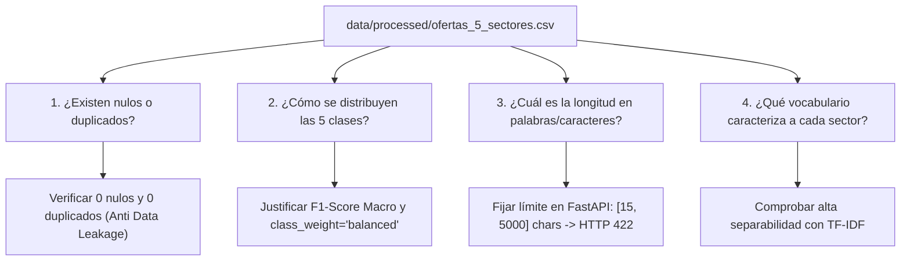

# 🔍 Paso 1.3: Análisis Exploratorio de Datos (EDA) en Notebook

> [!info] ¿Qué se construyó en este paso?
> Se implementó el notebook interactivo [`notebooks/01_eda.ipynb`](file:///e:/desarrollador/topicos/jefofcaz_clasificador_empleos/notebooks/01_eda.ipynb).
> 
> Realiza la **inspección médica y forense del dataset procesado** (`data/processed/ofertas_5_sectores.csv`) para responder a todas las exigencias del **punto 5.1 del documento de la materia** (distribución de clases, longitud de textos, nulos, duplicados y vocabulario).

---

## 1. El Propósito del EDA en NLP (El "Por Qué")

En Machine Learning tradicional con números se calculan correlaciones. En NLP, el texto tiene riesgos específicos:
- Si hay **duplicados**, se produce *Data Leakage* (fuga de datos) y el modelo memoriza en vez de generalizar.
- Si hay **clases desbalanceadas**, la métrica *Accuracy* es una mentira matemática.
- Si no conocemos la **longitud de los textos**, no sabemos qué límites poner a la API en producción para evitar ataques DoS o textos basura.
- Si los sectores **no tienen vocabulario diferenciado**, TF-IDF fallará.



---

## 2. ¿Para qué sirven los Notebooks (`.ipynb`) en Machine Learning?

Un **Jupyter Notebook** es un entorno computacional interactivo que combina **código ejecutable en celdas**, **texto enriquecido en Markdown** y **visualizaciones gráficas empotradas**.

### ¿Cuál es su utilidad real?
1. **Experimentación rápida e iterativa:** En un script tradicional `.py`, cada vez que cambias una línea de código para ajustar el color o tamaño de un gráfico, tienes que volver a leer el archivo CSV y recalcular todo desde cero. En un notebook, el dataset se queda cargado en la **memoria RAM** del kernel; puedes modificar solo la celda del gráfico y ejecutarla al instante (`Shift + Enter`).
2. **Inspección forense visual (EDA):** Permite ver tablas de Pandas formateadas, gráficos de barras, histogramas y matrices de dispersión en el mismo documento donde se describe la hipótesis.
3. **Bitácora narrativa viva:** Sirve como informe científico reproducible donde el profesor o evaluador puede leer la explicación de un hallazgo y ver inmediatamente debajo el código y la gráfica que lo demuestran.

### ⚠️ Notebooks vs. Código de Producción (`src/`): Regla de Oro
> [!warning] La Regla de Arquitectura (Regla 1.9 de las normas del proyecto)
> **Los notebooks son únicamente para explorar y diagnosticar. En cuanto una lógica funciona, se extrae a módulos limpios en `src/`.**

| Aspecto | Notebook (`notebooks/*.ipynb`) | Módulo de Producción (`src/*.py`) |
|---|---|---|
| **Propósito** | Exploración, prototipado, visualizaciones y toma de decisiones. | Pipeline automatizado, lógica de negocio y backend. |
| **Ejecución** | Manual celda por celda o interactiva. | Determinista, secuencial y automatizada. |
| **Pruebas** | No integrable con `pytest` de forma nativa. | 100% testeable con aserciones automatizadas. |
| **Consumo por API** | **Prohibido:** FastAPI no puede ni debe importar un `.ipynb`. | FastAPI importa clases y funciones puras directamente. |
| **Riesgo oculto** | *Out-of-order execution* (ejecutar celdas en desorden crea variables fantasma). | Cero estado oculto; sigue el flujo estricto del lenguaje. |
| **Git / Versiones** | Diffs ruidosos (archivos JSON con metadatos e imágenes binarias). | Diffs limpios línea por línea (`git diff`). |

---

## 3. Las 4 Secciones del Notebook y sus Resultados Reales

### 3.1. Carga e Integridad
- Carga `data/processed/ofertas_5_sectores.csv`.
- Aserciones automáticas en el notebook:
  ```python
  assert df.isnull().sum().sum() == 0, "¡Existen valores nulos!"
  assert df.duplicated(subset=['texto']).sum() == 0, "¡Existen textos duplicados!"
  ```
- **Resultado:** `VERIFICACION DE INTEGRIDAD: 100% LIMPIO (0 nulos, 0 duplicados)`.

### 3.2. Distribución de las 5 Clases
Resultados calculados sobre las **3.337 ofertas**:

| Sector | Cantidad de Ofertas | Porcentaje Poblacional |
|---|:---:|:---:|
| `salud_servicios_sociales` | 958 | 28.71% |
| `transporte_logistica` | 914 | 27.39% |
| `construccion_mantenimiento` | 856 | 25.65% |
| `hosteleria_gastronomia` | 409 | 12.26% |
| `ventas_comercial` | 200 | 5.99% |

> **🌟 Conclusión de defensa ante el docente:**  
> Hay un desbalance natural de clases (desde 28.7% hasta 6.0%). Si usáramos la métrica *Accuracy*, un modelo tramposo que siempre prediga "Salud" obtendría casi 30% de acierto sin haber aprendido nada de ventas.  
> Por eso justificamos formalmente el uso de **F1-Score Macro** (promedia el acierto de cada sector por igual) y el parámetro `class_weight='balanced'` en la Regresión Logística.

### 3.3. Longitud de los Textos: Percentiles y Contrato de la API
Estadísticas calculadas en palabras y caracteres:

| Métrica | Longitud en Palabras | Longitud en Caracteres |
|---|:---:|:---:|
| **Mínimo** | 3 palabras | 20 caracteres |
| **Percentil 25 (P25)** | 28 palabras | 196 caracteres |
| **Mediana (P50)** | **44 palabras** | **315 caracteres** |
| **Percentil 75 (P75)** | 73 palabras | 512 caracteres |
| **Percentil 95 (P95)** | 185 palabras | 1.258 caracteres |
| **Percentil 99 (P99)** | 274 palabras | 1.827 caracteres |
| **Máximo** | 719 palabras | 4.672 caracteres |

> **🌟 Ejemplo Práctico: Justificación de Validación en FastAPI (`schemas.py`):**
> 1. **Mínimo de 15 caracteres:** Si un usuario envía `"busco trabajo"` (13 caracteres), no hay suficiente contexto para que TF-IDF extraiga términos discriminantes. La API rechaza la petición de inmediato con **HTTP 422 Unprocessable Entity**.
> 2. **Máximo de 5.000 caracteres:** El 99% de las ofertas reales (P99) tiene menos de 1.827 caracteres. Fijar el límite en 5.000 protege a la API contra ataques de Denegación de Servicio (DoS) por memoria masiva, permitiendo procesar el 100% de ofertas legítimas.

### 3.4. Vocabulario y Separabilidad con TF-IDF
Top términos característicos extraídos por sector:

| Sector | Vocabulario Más Frecuente |
|---|---|
| `transporte_logistica` | conductor, camion, vehiculo, mercancias, reparto, almacen, carretillero, ruta |
| `hosteleria_gastronomia` | cocina, camarero, restaurante, platos, menu, sala, barra, elaboracion |
| `ventas_comercial` | comercial, clientes, ventas, seguros, asesoramiento, cartera, prospeccion |
| `salud_servicios_sociales` | enfermeria, usuarios, atencion, residencia, mayores, cuidados, dependientes |
| `construccion_mantenimiento` | mantenimiento, instalacion, electrico, mecanico, obra, climatizacion, reparacion |

> **🌟 Ejemplo Intuitivo de TF-IDF:**
> - La palabra **`conductor`** aparece en el 70% de las ofertas de transporte, pero en el 0% de hostelería o salud. Por eso, su peso TF-IDF es altísimo para clasificar transporte.
> - La palabra **`empresa`** aparece en casi todos los sectores. Su frecuencia inversa de documento (IDF) es cercana a cero, por lo que el modelo la ignora automáticamente como ruido común.

---

## 4. Cómo Ejecutar el Notebook y Solución de Problemas

### Opción A: Directamente en VS Code (Recomendada)
1. Abre [`notebooks/01_eda.ipynb`](file:///e:/desarrollador/topicos/jefofcaz_clasificador_empleos/notebooks/01_eda.ipynb).
2. Arriba a la derecha, haz clic en **"Select Kernel"** $\rightarrow$ **Python Environments** $\rightarrow$ **`.venv` (Python 3.12)**.
3. Haz clic en **"Run All"**.

> [!tip] Notas de Utilidad y Troubleshooting en VS Code
> * **¿Se ve como texto plano JSON?** Instala la extensión oficial **"Jupyter"** de Microsoft en la pestaña de extensiones (`Ctrl + Shift + X`).
> * **¿Error `ModuleNotFoundError: No module named 'seaborn'`?** Cambia el kernel arriba a la derecha para seleccionar el `.venv` del proyecto y no el Python del sistema.
> * **Regla de Sanidad (Evitar variables fantasma):** Antes de guardar un notebook, presiona `0, 0` (*Restart Kernel*) y luego haz clic en *Run All*. Si corre completo sin frenarse, tu análisis es 100% reproducible.

### Opción B: Ejecución por Terminal (Headless)
```powershell
jupyter nbconvert --to notebook --execute notebooks/01_eda.ipynb --output notebooks/01_eda.ipynb
```

---

## 5. Dónde Cambiar lo Importante
- Para ajustar stop words de visualización: En la variable `STOPWORDS_BASICAS` de la celda 4 del notebook.
- Para cambiar límites de validación de la API: En [`params.yaml`](file:///e:/desarrollador/topicos/jefofcaz_clasificador_empleos/params.yaml) (`min_chars`, `max_chars`).
