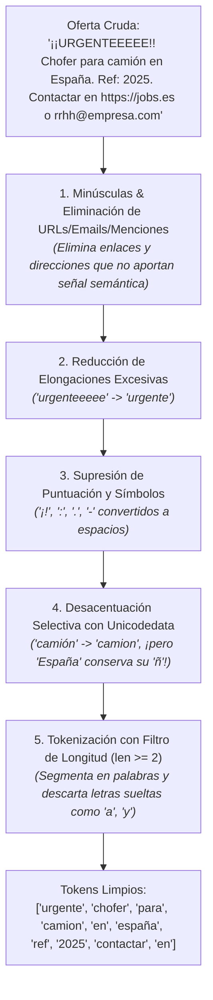

# 🧼 Paso 2.1: Limpieza Base, Expresiones Regulares y Respeto a la Ñ

> [!info] ¿Qué se construyó en este paso?
> Se implementó el módulo de funciones puras de normalización en [`src/nlp/cleaning.py`](file:///e:/desarrollador/topicos/jefofcaz_clasificador_empleos/src/nlp/cleaning.py) y su correspondiente suite de pruebas unitarias automatizadas en [`tests/test_cleaning.py`](file:///e:/desarrollador/topicos/jefofcaz_clasificador_empleos/tests/test_cleaning.py).
> 
> Es la **primera línea de defensa** del pipeline de NLP: toma el texto libre y ruidoso de las ofertas laborales y lo transforma en una lista de tokens atómicos limpios, sin ruido tipográfico y con preservación estricta de la lingüística del español.

---

## 1. Justificación Técnica: El "Por Qué" de Cada Transformación

Cuando un reclutador o empresa publica una vacante en internet, el texto presenta 5 problemas clásicos:



---

## 2. El Peligro de `unidecode` y la Solución con `unicodedata`

> [!danger] La "Trampa" de las Librerías en Inglés
> Muchas librerías populares de Python (como `unidecode`) fueron pensadas para el alfabeto inglés.  
> Si usas `unidecode`, convierte la letra **`ñ`** en **`n`**:
> * `"año"` $\rightarrow$ `"ano"` *(cambio de significado inaceptable)*.
> * `"campaña"` $\rightarrow$ `"campana"`.
> * `"diseño"` $\rightarrow$ `"diseno"`.

### La Solución Implementada:
Usamos el módulo nativo de Python `unicodedata` con un **procedimiento de blindaje centinela**:
1. Reemplazamos temporalmente la `ñ` y `Ñ` por caracteres centinela especiales (`\0`, `\1`).
2. Descomponemos el texto a formato **NFD** (*Normalization Form Canonical Decomposition*), separando las letras de sus acentos gráficos (categoría `Mn` o *Mark, Nonspacing*).
3. Filtramos los acentos (tildes `´` y diéresis `¨`).
4. Restauramos los centinelas a `ñ` y `Ñ`.

```python
# Fragmento real de src/nlp/cleaning.py
centinela_min = "\u0000"
centinela_may = "\u0001"
texto_blindado = texto.replace("ñ", centinela_min).replace("Ñ", centinela_may)
texto_descompuesto = unicodedata.normalize("NFD", texto_blindado)
texto_sin_tildes = "".join(c for c in texto_descompuesto if unicodedata.category(c) != "Mn")
resultado = texto_sin_tildes.replace(centinela_min, "ñ").replace(centinela_may, "Ñ")
```

---

## 3. Las 4 Funciones Creadas en `src/nlp/cleaning.py`

| Función | ¿Qué recibe? | ¿Qué entrega? | Propósito |
|---|---|---|---|
| `normalizar_elongaciones(texto)` | `str` | `str` | Reduce secuencias de 3 o más letras iguales a una sola (`re.sub(r"(\w)\1{2,}", r"\1", texto)`). Respeta dígrafos legítimos como `"rr"`, `"ll"` y `"cc"`. |
| `desacentuar_conservando_ene(texto)` | `str` | `str` | Quita tildes agudas y diéresis, pero protege intacta la letra `ñ` y `Ñ`. |
| `limpiar_texto_base(texto, remover_tildes=True)` | `Optional[str]` | `str` | Orquestador de limpieza: pasa a minúsculas, elimina URLs (`https?://`), correos (`@`), signos y colapsa espacios. |
| `tokenizar_palabras(texto, min_length=2)` | `Optional[str]` | `List[str]` | Segmenta el texto en lista de palabras, eliminando caracteres de longitud 1 (`"a"`, `"y"`, `"o"`). |

---

## 4. Ejemplos Prácticos Reales (Entrada $\rightarrow$ Salida)

### 🌟 Ejemplo 1: Convocatoria con Ruido Web y Mayúsculas
* **Entrada cruda:**
  > `"¡¡¡OFERTA URGENTEEEEE!!! Chofer para camión. Postular en https://eures.europa.eu o escribir a rrhh@empresa.es vía @empleos_es. 2 años de experiencia mínima."`
* **Paso 1 (limpiar_texto_base):**
  > `"oferta urgente chofer para camion postular en o escribir a via 2 años de experiencia minima"`
* **Paso 2 (tokenizar_palabras):**
  > `["oferta", "urgente", "chofer", "para", "camion", "postular", "en", "escribir", "via", "2", "años", "de", "experiencia", "minima"]` *(las letras sueltas `"o"` y `"a"` se descartan automáticamente).*

### 🌟 Ejemplo 2: Preservación Lingüística de la Ñ y Dígrafos
* **Entrada:** `"AÑORANZA de un carro nuevo en otoño con cigüeña"`
* **Salida de desacentuar_conservando_ene:**
  > `"AÑORANZA de un carro nuevo en otoño con cigueña"`  
  *(La diéresis de cigüeña y las tildes se van; `Ñ`, `ñ` y el dígrafo `rr` de carro quedan perfectos).*

---

## 5. Pruebas Unitarias Verificadas (`tests/test_cleaning.py`)

Se escribieron 5 pruebas con casos calculados a mano:
1. `test_desacentuar_conservando_ene_ejemplos_a_mano`: Comprueba vocales con tildes, mayúsculas y palabras con `ñ`.
2. `test_normalizar_elongaciones_ejemplos_a_mano`: Verifica que `"buenoooooo"` sea `"bueno"` pero `"carro"` y `"llave"` se mantengan intactos.
3. `test_limpiar_texto_base_oferta_real`: Verifica el descarte de URLs, emails y menciones.
4. `test_tokenizar_palabras_filtrado_longitud`: Verifica el descarte de tokens de longitud $< 2$.
5. `test_casos_borde_entradas_vacias`: Valida que `None`, `""` y cadenas de solo espacios devuelvan cadenas vacías o listas vacías sin lanzar excepciones no controladas.

---

## 6. Comandos de Ejecución en Git Bash

```bash
# Ejecutar únicamente las pruebas de este paso
.venv/Scripts/python -m pytest tests/test_cleaning.py -v

# Ejecutar la suite completa de pruebas del proyecto (24 pruebas)
.venv/Scripts/python -m pytest -v
```

---

## 7. Dónde Cambiar lo Importante
* Para agregar nuevos patrones de exclusión (ej. teléfonos o números de referencia): En las expresiones regulares compiladas al inicio de [`src/nlp/cleaning.py`](file:///e:/desarrollador/topicos/jefofcaz_clasificador_empleos/src/nlp/cleaning.py).
* Para modificar la longitud mínima de palabras admitidas: Parámetro `min_length` de `tokenizar_palabras()`.
