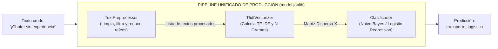

# ⚙️ Paso 2.3: Clase Unificada TextPreprocessor y Auditoría con `.explain()`

> [!NOTE] ¿Qué se construyó en este paso?
> Se implementó la clase universal [`src/nlp/preprocessing.py`](file:///e:/desarrollador/topicos/jefofcaz_clasificador_empleos/src/nlp/preprocessing.py) (`TextPreprocessor`) y su suite de pruebas unitarias en [`tests/test_preprocessing.py`](file:///e:/desarrollador/topicos/jefofcaz_clasificador_empleos/tests/test_preprocessing.py).
> 
> Esta clase es el **núcleo unificador de la Fase 2**: conecta en un único objeto reutilizable la limpieza base, tokenización, stop words protegidas y reducción morfológica. Además, implementa el contrato de Scikit-Learn (`BaseEstimator`, `TransformerMixin`) para acoplarse directamente al `Pipeline` y expone el método forense `.explain()` para alimentar la API REST (FastAPI) y la interfaz visual (React).

---

## 1. Justificación Técnica: La Cinta Transportadora de Scikit-Learn

En un proyecto de Machine Learning profesional, **el preprocesamiento nunca se ejecuta como scripts sueltos**. Si la API o el frontend tuvieran que aplicar la limpieza por su cuenta, existiría un alto riesgo de inconsistencia (*data leakage* o desfase de reglas).

Para resolver esto, `TextPreprocessor` convierte la lógica lingüística en un **Transformador Estándar de Scikit-Learn**:



---

## 2. El Contrato de Scikit-Learn: `BaseEstimator` y `TransformerMixin`

Para que Scikit-Learn reconozca a nuestra clase como un transformador nativo compatible con `Pipeline`, `GridSearchCV` y `clone()`, debe cumplir 3 reglas fundamentales:

| Método / Regla | Implementación en `TextPreprocessor` | ¿Por qué es obligatorio? |
|---|---|---|
| `__init__()` **sin mutación** | Guarda los argumentos directamente en `self` con el mismo nombre exacto (`self.metodo_morfologia = metodo_morfologia`). | `sklearn.base.clone()` inspecciona la firma de `__init__`. Si modificas o creas atributos no declarados, la clonación falla. |
| `fit(X, y=None)` | Retorna `self` sin calcular estado numérico. | El preprocesamiento lingüístico es determinista (reglas fijas); no depende de las etiquetas ni de parámetros aprendidos. |
| `transform(X)` | Itera sobre `X` (listas, `pd.Series` o arrays) y devuelve `List[str]`. | Entrega texto plano limpio y separado por espacios, que es el formato exacto requerido por `TfidfVectorizer`. |
| `fit_transform(X, y=None)` | Provisto automáticamente por `TransformerMixin`. | Permite entrenar y transformar en un solo llamado eficiente. |

---

## 3. El Método `.explain(texto)`: Auditoría Visual para la Web

El requerimiento del proyecto exige que la interfaz web (React) y la API REST (FastAPI) muestren al usuario exactamente **qué le pasó a su texto en cada estación del pipeline**.

El método `.explain(texto: str) -> Dict[str, Any]` genera este desglose estructurado sin duplicar código:

```python
# Ejemplo de llamada:
tp = TextPreprocessor(metodo_morfologia="stem")
auditoria = tp.explain("¡URGENTE! Chofer de camión sin experiencia en España.")
```

### Salida real producida por `.explain()`:

```json
{
  "original": "¡URGENTE! Chofer de camión sin experiencia en España.",
  "normalizado": "urgente chofer de camion sin experiencia en españa",
  "tokens": ["urgente", "chofer", "de", "camion", "sin", "experiencia", "en", "españa"],
  "sin_stopwords": ["urgente", "chofer", "camion", "sin", "experiencia", "españa"],
  "morfologia": ["urgent", "chofer", "camion", "sin", "experienci", "españ"],
  "final": ["urgent", "chofer", "camion", "sin", "experienci", "españ"],
  "texto_final": "urgent chofer camion sin experienci españ"
}
```

> [!IMPORTANT] Puntos clave de la auditoría
> 1. **La negación `"sin"` sobrevive:** En `"sin_stopwords"` y `"final"`, `"sin"` no se eliminó gracias a `NEGACIONES_BLINDADAS`.
> 2. **La `"ñ"` sobrevive intacta:** `"españa"` mantiene la `ñ` durante la normalización y el desacentuado.
> 3. **Consumo directo en React:** El frontend mapeará este diccionario directamente en tarjetas visuales de progreso.

---

## 4. Alternancia Dinámica: Stemming vs Lematización vs None

La clase permite alternar la estrategia morfológica con un único parámetro:

```python
# 1. Stemming rápido con Snowball (ideal para alta velocidad en producción)
tp_stem = TextPreprocessor(metodo_morfologia="stem")

# 2. Lematización precisa con spaCy (ideal para máxima precisión lingüística)
tp_lemma = TextPreprocessor(metodo_morfologia="lemma")

# 3. Sin reducción (conserva las palabras tal cual para modelos de n-gramas puros)
tp_none = TextPreprocessor(metodo_morfologia="none")
```

---

## 5. Casos Borde Blindados

1. **Entrada `None`:** Devuelve diccionario con `original: ""` y listas vacías `[]`.
2. **Cadenas vacías (`""`) o de solo espacios (`"   \t\n"`):** Retorna `texto_final: ""` sin disparar excepciones.
3. **Solo signos de puntuación (`"??? !!! ---"`):** Limpia completamente y entrega listas vacías.
4. **Solo números (`"12345"`):** Tokeniza sin romper el formateador.
5. **Entrada masiva heterogénea en `transform()`:** Acepta tanto listas nativas `list[str]` como columnas de Pandas `pd.Series`.

---

## 6. Pruebas Unitarias Verificadas (`tests/test_preprocessing.py`)

Se diseñaron 5 pruebas automatizadas rigurosas que validan el comportamiento:

| Prueba | Qué valida |
|---|---|
| `test_scikit_learn_interface_y_clone` | Validación del protocolo Scikit-Learn: `clone()` exitoso con hiperparámetros intactos, `fit()` retorna `self`, y `fit_transform()` genera lista de strings. |
| `test_explain_auditoria_completa_con_negacion` | Valida el contrato de claves de `.explain()` y confirma que `"sin"` y la letra `"ñ"` se conservan en la salida final. |
| `test_transform_con_pandas_series_y_listas` | Comprueba paridad de salida entre `list` de Python y `pd.Series` de Pandas. |
| `test_selector_morfologia_stem_lemma_none` | Verifica que `"stem"` aplique Snowball, `"lemma"` produzca lemas canónicos de spaCy y `"none"` no altere los tokens filtrados. |
| `test_casos_borde_preprocesador` | Verifica que `None`, cadenas vacías y solo símbolos retornen estructuras válidas sin excepciones. |

---

## 7. Comandos de Ejecución en Git Bash

```bash
# Ejecutar las pruebas unitarias de este paso
.venv/Scripts/python -m pytest tests/test_preprocessing.py -v

# Ejecutar la suite completa del proyecto (36 pruebas pasando)
.venv/Scripts/python -m pytest -v
```

---

## 8. Dónde Cambiar lo Importante

| Requisito o Ajuste | Archivo | Parámetro |
|---|---|---|
| Alternar entre Stemming y Lematización | Constructor de `TextPreprocessor` | `metodo_morfologia="stem"` o `"lemma"` |
| Desactivar filtrado de stop words | Constructor de `TextPreprocessor` | `usar_stopwords=False` |
| Cambiar longitud mínima de tokens | Constructor de `TextPreprocessor` | `min_token_len=3` |
| Cambiar palabras protegidas o comodines | `params.yaml` | `nlp.keep_words` y `nlp.extra_stopwords` |
| Importar la clase en cualquier módulo | Código Python | `from src.nlp import TextPreprocessor` |
