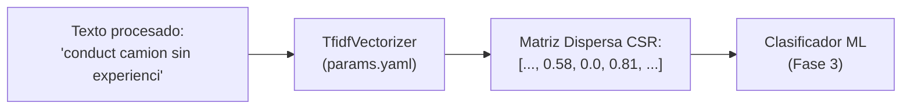

# 📐 Paso 2.4: Vectorización TF-IDF, N-Gramas y Ensamblado del Pipeline Base

> [!NOTE] ¿Qué se construyó en este paso?
> Se implementó el módulo de ensamblado y vectorización en [`src/nlp/pipeline.py`](file:///e:/desarrollador/topicos/jefofcaz_clasificador_empleos/src/nlp/pipeline.py) y su suite de pruebas unitarias en [`tests/test_pipeline.py`](file:///e:/desarrollador/topicos/jefofcaz_clasificador_empleos/tests/test_pipeline.py).
> 
> Este paso cierra con éxito la **Fase 2 (Pipeline de NLP)**: convierte las cadenas de texto procesadas por `TextPreprocessor` en coordenadas matemáticas de alta dimensionalidad mediante **TF-IDF con unigramas y bigramas `(1, 2)`**, centralizado a través de `params.yaml`, y ensamblado en un `Pipeline` de Scikit-Learn listo para producción.

---

## 1. El Puente Matemático: De Palabras a Vectores Numéricos

Los modelos matemáticos (Regresión Logística, Naive Bayes, Redes Neuronales) son incapaces de interpretar caracteres alfabéticos. Necesitan una matriz numérica bidimensional $X \in \mathbb{R}^{n \times m}$ donde cada fila representa una oferta laboral y cada columna representa una característica lingüística (palabra o bigrama).



---

## 2. N-Gramas: Captura del Contexto y Negaciones Compuestas

Cuando vectorizamos únicamente palabras sueltas (**unigramas**, `ngram_range=(1, 1)`), destruimos el orden sintáctico. 

Por ejemplo, la frase `"sin experiencia"` se descompone en `"sin"` y `"experiencia"` por separado. Un modelo lineal podría interpretar la presencia de `"experiencia"` como algo positivo para un puesto senior, perdiendo el matiz restrictivo.

Al configurar **`ngram_range=(1, 2)`** (unigramas + bigramas):
- Se generan características individuales: `"conductor"`, `"camion"`, `"sin"`, `"experienci"`.
- Se generan pares contiguos: `"conductor camion"`, `"camion sin"`, **`"sin experienci"`**.

> [!TIP] Impacto en el Modelo
> El bigrama `"sin experienci"` recibe su propio peso independiente en el clasificador, permitiendo discriminar con precisión quirúrgica vacantes de entrada frente a ofertas que exigen trayectoria laboral demostrable.

---

## 3. Los 4 Hiperparámetros Clave de `params.yaml` (Defensa Oral)

Los parámetros de vectorización no se eligen por azar; se gobiernan centralmente desde [`params.yaml`](file:///e:/desarrollador/topicos/jefofcaz_clasificador_empleos/params.yaml):

```yaml
tfidf:
  max_features: 4000       # Limite del vocabulario
  min_df: 2                # Ignorar terminos que aparecen en menos de 2 ofertas
  max_df: 0.85             # Ignorar terminos omnipresentes en mas del 85% de ofertas
  sublinear_tf: true       # Escala logaritmica 1 + log(tf) para evitar que terminos repetidos dominen
```

| Hiperparámetro | Valor | Justificación Técnica para la Rúbrica |
|---|:---:|---|
| **`max_features`** | `4000` | Limita el vocabulario a las 4.000 características con mayor puntaje TF-IDF global. Evita la "maldición de la dimensionalidad" (*curse of dimensionality*), previene sobreajuste (*overfitting*) y mantiene el consumo de RAM bajo control. |
| **`min_df`** | `2` | Descarta términos que aparecen en menos de 2 documentos. Elimina erratas tipográficas únicas (*typos* accidentales) que no tienen valor predictivo estadístico. |
| **`max_df`** | `0.85` | Descarta términos que aparecen en más del 85% del corpus. Actúa como un filtro de *stop words de facto*, eliminando palabras tan universales que no discriminan entre sectores. |
| **`sublinear_tf`** | `True` | Aplica la fórmula sublineal $\text{TF}_{\text{sublinear}} = 1 + \ln(\text{TF})$ para $\text{TF} > 0$. Implementa la **ley de rendimientos decrecientes**: una oferta que repite `"urgente"` 5 veces no es 5 veces más relevante que una que lo dice 1 vez. |

---

## 4. Ejemplo Numérico Mínimo Calculado a Mano (Verificado con Pytest)

Para defender con total propiedad matemática cómo opera Scikit-Learn por debajo, tomemos un corpus de juguete con $N = 2$ documentos y unigramas:

* **Documento 1 ($D_1$):** `"camion camion"`
* **Documento 2 ($D_2$):** `"camion chofer"`

### Vocabulario Alfabético ($m = 2$ términos):
Columna 0 = `"camion"`, Columna 1 = `"chofer"`.

### Paso 1: Cálculo de Frecuencia Inversa de Documento (IDF con suavizado)
La fórmula oficial de Scikit-Learn con `smooth_idf=True` es:
$$\text{IDF}(t) = \ln\left(\frac{1 + N}{1 + \text{DF}(t)}\right) + 1$$

* $\text{DF}(\text{camion}) = 2$ (aparece en $D_1$ y $D_2$):
  $$\text{IDF}(\text{camion}) = \ln\left(\frac{1 + 2}{1 + 2}\right) + 1 = \ln(1) + 1 = 0.0 + 1 = 1.0$$
* $\text{DF}(\text{chofer}) = 1$ (aparece solo en $D_2$):
  $$\text{IDF}(\text{chofer}) = \ln\left(\frac{1 + 2}{1 + 1}\right) + 1 = \ln(1.5) + 1 \approx 0.405465 + 1 = 1.405465$$

### Paso 2: Cálculo de TF Sublineal
$$\text{TF}_{\text{sublinear}}(t, d) = 1 + \ln(\text{TF}(t, d))$$

* Para $D_1$:
  * $\text{TF}(\text{camion}) = 2 \implies \text{TF}_{\text{sublinear}} = 1 + \ln(2) = 1 + 0.693147 = 1.693147$.
  * $\text{TF-IDF}_{\text{crudo}}(\text{camion}) = 1.693147 \times 1.0 = 1.693147$.
  * Normalización euclidiana L2 (único término): $\frac{1.693147}{\sqrt{1.693147^2}} = \mathbf{1.0}$.
* Para $D_2$:
  * Ambos términos aparecen 1 sola vez $\implies \text{TF}_{\text{sublinear}} = 1 + \ln(1) = 1.0$.
  * $\text{TF-IDF}_{\text{crudo}}(\text{camion}) = 1.0 \times 1.0 = 1.0$.
  * $\text{TF-IDF}_{\text{crudo}}(\text{chofer}) = 1.0 \times 1.405465 = 1.405465$.
  * Norma L2 del vector:
    $$\|D_2\|_2 = \sqrt{1.0^2 + 1.405465^2} = \sqrt{1.0 + 1.975332} = \sqrt{2.975332} \approx 1.724915$$
  * Coordenadas finales normalizadas de $D_2$:
    * Para `"camion"`: $\frac{1.0}{1.724915} \approx \mathbf{0.5797}$
    * Para `"chofer"`: $\frac{1.405465}{1.724915} \approx \mathbf{0.8148}$

> [!IMPORTANT] Conclusión Matemática
> En el Documento 2, la palabra `"chofer"` recibe un peso considerablemente mayor ($0.8148$) que `"camion"` ($0.5797$) a pesar de que ambas aparecen una sola vez en el texto. Esto demuestra que **TF-IDF premia los términos raros y discriminativos y penaliza las palabras omnipresentes**.  
> *(Este cálculo exacto está automatizado y verificado con `pytest.approx` en [`tests/test_pipeline.py`](file:///e:/desarrollador/topicos/jefofcaz_clasificador_empleos/tests/test_pipeline.py)).*

---

## 5. Arquitectura del Pipeline Unificado

La función `crear_pipeline_nlp()` encapsula todo el ciclo:

```python
from src.nlp.pipeline import crear_pipeline_nlp
from sklearn.linear_model import LogisticRegression

# Ensamblado en una sola lnea:
pipeline = crear_pipeline_nlp(modelo=LogisticRegression(C=2.0))

# 1. Se entrena de punta a punta:
pipeline.fit(X_train, y_train)

# 2. Se serializa en un nico archivo inmutable:
import joblib
joblib.dump(pipeline, "artifacts/model.joblib")

# 3. En produccin (FastAPI), predice directamente sobre texto crudo:
prediccion = pipeline.predict(["Se busca fontanero urgente para reparacin"])
```

### Ventajas Arquitecturales:
1. **Cero Data Leakage:** El vocabulario y el cálculo del IDF solo se ajustan (`fit`) sobre el conjunto de entrenamiento.
2. **Desacoplamiento Total del Backend:** FastAPI solo invoca `pipeline.predict()`; nunca necesita importar expresiones regulares ni listas de stop words.
3. **Serialización Atómica con Joblib:** Un único artefacto binario contiene el preprocesador, el vocabulario de 4.000 columnas y los coeficientes del modelo.

---

## 6. Pruebas Unitarias Verificadas (`tests/test_pipeline.py`)

6 pruebas automatizadas ejecutadas y pasando al 100%:

| Prueba | Qué valida |
|---|---|
| `test_tfidf_configuracion_defaults_params_yaml` | Comprueba que el vectorizador lea los parámetros oficiales de `params.yaml` (`max_features=4000`, `min_df=2`, `max_df=0.85`, `sublinear_tf=True`, `ngram_range=(1, 2)`). |
| `test_tfidf_calculo_a_mano_dos_documentos` | Verifica con tolerancia numérica estricta el cálculo matemático a mano de IDF, TF sublineal y normalización L2. |
| `test_tfidf_captura_bigramas_clave` | Verifica que `ngram_range=(1, 2)` genere combinaciones como `"sin experiencia"` y `"conductor camion"`. |
| `test_pipeline_unificado_transformacion_y_sparse_matrix` | Comprueba que el Pipeline ejecute preprocesamiento y genere una matriz dispersa `csr_matrix` eficiente en memoria. |
| `test_pipeline_con_clasificador_baseline` | Acopla un clasificador Naive Bayes, ejecuta `fit()`, realiza inferencias y valida que las probabilidades predichas sumen exactamente 1.0. |
| `test_pipeline_serializacion_y_recuperacion_joblib` | Serializa el pipeline a bytes con `joblib.dump` y verifica que al cargarlo mantenga idénticas predicciones. |

---

## 7. Comandos de Ejecución en Git Bash

```bash
# Ejecutar las pruebas de vectorizacion y pipeline
.venv/Scripts/python -m pytest tests/test_pipeline.py -v

# Ejecutar la suite completa de pruebas del proyecto (42 pruebas en verde)
.venv/Scripts/python -m pytest -v
```

---

## 8. Dónde Cambiar lo Importante

| ¿Qué deseas ajustar? | Archivo a modificar | Parámetro |
|---|---|---|
| Límite del vocabulario de palabras | `params.yaml` | `tfidf.max_features` |
| Umbral de palabras raras (mínimo) | `params.yaml` | `tfidf.min_df` |
| Umbral de palabras omnipresentes (máximo) | `params.yaml` | `tfidf.max_df` |
| Alternar entre solo unigramas o unigramas+bigramas | `params.yaml` | `experiments.ngram_ranges` |
| Acoplar un nuevo estimador de ML al pipeline | Código Python | `crear_pipeline_nlp(modelo=MiNuevoModelo())` |
