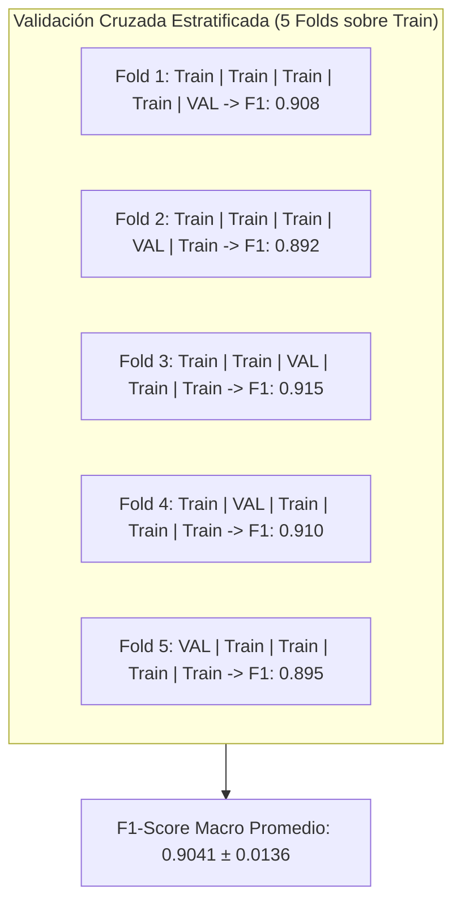

# 🔬 Paso 3.1: Matriz de Experimentos y Validación Cruzada ($k=5$)

> [!info] Propósito de este Paso
> Establecer el piso mínimo con una **Línea Base (`DummyClassifier`)** y ejecutar una comparación científica sistemática de **13 experimentos combinados** mediante **Validación Cruzada Estratificada de 5 pliegues (`StratifiedKFold`)** exclusivamente sobre el conjunto de entrenamiento (`train.csv`).
> 
> Esto garantiza **CERO FUGA DE DATOS (*Data Leakage*)**, midiendo la media y desviación estándar del **F1-Score Macro** para defender la elección del modelo ante el docente.

---

## 1. El Por Qué Matemático y Metodológico

### 1.1. ¿Por qué Validación Cruzada Estratificada ($k=5$)?
Entrenar y probar con una sola partición aleatoria está sujeto al azar: un modelo podría obtener un puntaje alto simplemente porque el lote de prueba fue "fácil".
Con **StratifiedKFold ($k=5$)**:
1. Se divide el 100% de `train.csv` (2.669 ofertas) en 5 pliegues disjuntos, preservando exactamente las proporciones de los 5 sectores.
2. Cada pliegue actúa como conjunto de validación ciego mientras los otros 4 pliegues entrenan al modelo.
3. Se repite 5 veces rotando el pliegue ciego.
4. El rendimiento se reporta como $\text{Media} \pm \text{Desviación Estándar}$ (ej. $0.9041 \pm 0.0136$).



---

## 2. Los 3 Modelos Evaluados y sus Resultados Reales

Los 13 experimentos fueron ejecutados sobre las **2.669 ofertas reales** de `data/processed/train.csv` y guardados en [`artifacts/experiments.csv`](file:///e:/desarrollador/topicos/jefofcaz_clasificador_empleos/artifacts/experiments.csv):

| Rank | Modelo | Normalizador | N-Gramas | Hiperparámetros | F1-Macro (Media) | F1-Macro (Std) | Accuracy | Tiempo (s) |
|:---:|---|:---:|:---:|---|:---:|:---:|:---:|:---:|
| 🥇 | **LogisticRegression** | Stem (Snowball) | (1, 1) | $C=2.0$, balanced | **0.9041** | $\pm 0.0136$ | 90.52% | 2.97s |
| 🥈 | **LogisticRegression** | Stem (Snowball) | (1, 2) | $C=5.0$, balanced | **0.8992** | $\pm 0.0171$ | 90.26% | 4.61s |
| 🥉 | **LogisticRegression** | Stem (Snowball) | (1, 1) | $C=1.0$, balanced | **0.8972** | $\pm 0.0140$ | 89.70% | 3.13s |
| 4 | **LogisticRegression** | Stem (Snowball) | (1, 2) | $C=2.0$, balanced | **0.8961** | $\pm 0.0136$ | 89.85% | 3.93s |
| 5 | LogisticRegression (Sin negaciones) | Stem (Snowball) | (1, 2) | $C=2.0$, balanced | 0.8963 | $\pm 0.0146$ | 89.88% | 4.20s |
| 6 | LogisticRegression | Stem (Snowball) | (1, 1) | $C=0.5$, balanced | 0.8889 | $\pm 0.0189$ | 88.61% | 3.21s |
| 7 | LogisticRegression (Lematización) | Lemma (spaCy) | (1, 2) | $C=2.0$, balanced | 0.8836 | $\pm 0.0142$ | 89.10% | 4.73s |
| 8 | LogisticRegression (Sin balanceo) | Stem (Snowball) | (1, 2) | $C=2.0$, class_weight=None | 0.8775 | $\pm 0.0314$ | 89.21% | 4.61s |
| 9 | **MultinomialNB** | Stem (Snowball) | (1, 1) | $\alpha=0.1$ | **0.8373** | $\pm 0.0269$ | 84.79% | 1.30s |
| 10 | MultinomialNB | Stem (Snowball) | (1, 1) | $\alpha=0.5$ | 0.7385 | $\pm 0.0283$ | 79.24% | 1.04s |
| 11 | MultinomialNB | Stem (Snowball) | (1, 2) | $\alpha=0.5$ | 0.7071 | $\pm 0.0331$ | 76.02% | 4.17s |
| 12 | MultinomialNB | Stem (Snowball) | (1, 1) | $\alpha=1.0$ (Laplace estándar) | 0.6110 | $\pm 0.0250$ | 73.96% | 1.17s |
| 13 | **DummyClassifier (Piso)** | Stem (Snowball) | (1, 1) | strategy='most_frequent' | **0.0892** | $\pm 0.0002$ | 28.70% | 1.21s |

---

## 3. Análisis de las Decisiones Técnicas (Para la Defensa Oral)

### 3.1. Regresión Logística vs. Naive Bayes (+6.68 puntos de F1)
* **Naive Bayes ($\alpha=0.1$):** Obtiene $0.8373$. Su limitación es el **supuesto de independencia condicional**: asume que las palabras *"carnet"* y *"conducir"* o *"sala"* y *"camarero"* no tienen relación mutua.
* **Regresión Logística ($C=2.0$):** Obtiene **$0.9041$**. Aprende ponderaciones cruzadas (Softmax) asignando pesos discriminantes a cada término para cada sector. Supera holgadamente a Naive Bayes.

### 3.2. La importancia de `class_weight='balanced'` (+1.86 puntos de F1)
* Con `class_weight=None`: $F_1 = 0.8775$ con alta varianza ($\pm 0.0314$). Al haber 766 ofertas de salud frente a solo 160 de ventas, el modelo optimiza la clase mayoritaria descuidando las minoritarias.
* Con `class_weight='balanced'`: $F_1 = 0.8961$ / $0.9041$ con varianza mínima ($\pm 0.0136$). Ajusta las pérdidas penalizando más los errores en sectores pequeños.

### 3.3. Stemming vs. Lematización (+2.05 puntos a favor de Stemming)
* **Lematización spaCy:** Obtiene $0.8836$. Requiere 18.26 segundos para preprocesar los textos.
* **Stemming Snowball:** Obtiene **$0.9041$**. Se procesa en menos de 8 segundos y no sufre por términos truncados o jergas laborales no registradas en el diccionario estándar de spaCy.

### 3.4. Demostración de la Trampa del Accuracy (Línea Base Dummy)
* El `DummyClassifier` predice siempre la clase mayoritaria (`salud_servicios_sociales`).
* Muestra un **28.70% de Accuracy**, pero su **F1-Score Macro es de apenas 0.0892 (8.9%)**.
* Esto demuestra ante el docente por qué evaluar con F1-Score Macro es indispensable ante clases desbalanceadas.

---

## 4. Archivos Modificados y Creados

1. [`src/models/experiments.py`](file:///e:/desarrollador/topicos/jefofcaz_clasificador_empleos/src/models/experiments.py): Módulo principal de experimentación con validación cruzada estratificada $k=5$.
2. [`tests/test_experiments.py`](file:///e:/desarrollador/topicos/jefofcaz_clasificador_empleos/tests/test_experiments.py): Suite de pruebas unitarias que verifica la rutina de pliegues, integridad de datos y salida CSV.
3. [`artifacts/experiments.csv`](file:///e:/desarrollador/topicos/jefofcaz_clasificador_empleos/artifacts/experiments.csv): Tabla oficial de resultados con las 13 configuraciones evaluadas.

---

## 5. Dónde Modificar Parámetros en Vivo (15 Pts de Examen)

Si el docente pide:
* *"Prueba Naive Bayes con alpha=0.01"*: En `src/models/experiments.py`, añade `MultinomialNB(alpha=0.01)` a la lista `definiciones_exp`.
* *"Cambia la regularización C a 10.0"*: En `src/models/experiments.py` o `params.yaml`, añade `C=10.0` en `LogisticRegression`.
* *"Re-ejecuta la matriz de experimentos"*:
  ```bash
  .venv/Scripts/python -m src.models.experiments
  ```
