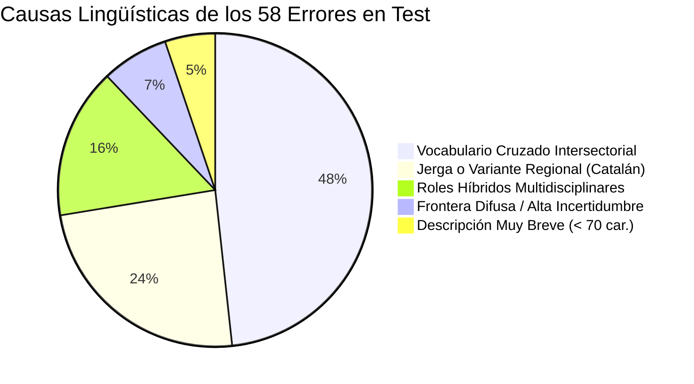

# 🏆 Paso 3.2: Entrenamiento del Modelo Ganador y Análisis de Errores

> [!info] Propósito de este Paso
> Entrenar el pipeline campeón con el 100% del conjunto de entrenamiento (`train.csv` - 2.669 ofertas) y evaluarlo a ciegas sobre el conjunto de prueba (`test.csv` - 668 ofertas).
> 
> Realizar el **Análisis de Errores obligatorio (Punto 5.3 del PDF)** clasificando lingüísticamente cada fallo del modelo y congelar los artefactos de producción:
> - [`artifacts/model.joblib`](file:///e:/desarrollador/topicos/jefofcaz_clasificador_empleos/artifacts/model.joblib)
> - [`artifacts/metrics.json`](file:///e:/desarrollador/topicos/jefofcaz_clasificador_empleos/artifacts/metrics.json)
> - [`artifacts/errors.csv`](file:///e:/desarrollador/topicos/jefofcaz_clasificador_empleos/artifacts/errors.csv)

---

## 1. El Pipeline Campeón Seleccionado

A partir de la comparación de 13 experimentos en la Fase 3.1, la arquitectura óptima es:

---

## 2. Rendimiento Oficial en el Conjunto de Prueba Ciego (Test Set)

Sobre **668 ofertas laborales reales nunca antes vistas**:

* **F1-Score Macro Oficial:** **`0.9155` (91.55%)**
* **Exactitud Global (Accuracy):** **`0.9132` (91.32%)**
* **Total Aciertos:** **610 / 668** (91.3%)
* **Total Errores:** **58 / 668** (8.7%)

### 2.1. Desglose Métrico por Sector (Reporte de Clasificación)

| Sector Laboral | Precision | Recall (Exhaustividad) | F1-Score | Casos Reales (Support) |
|---|:---:|:---:|:---:|:---:|
| **Construcción y Mantenimiento** | 0.9253 | 0.9415 | **0.9333** | 171 |
| **Hostelería y Gastronomía** | 0.9048 | 0.9268 | **0.9157** | 82 |
| **Salud y Servicios Sociales** | 0.9418 | 0.9271 | **0.9344** | 192 |
| **Transporte y Logística** | 0.8771 | 0.8579 | **0.8674** | 183 |
| **Ventas y Comercial** | 0.9048 | 0.9500 | **0.9268** | 40 |
| **Promedio Macro (Sin sesgo de tamaño)** | **0.9108** | **0.9207** | **0.9155** | **668** |

> [!tip] Victoria sobre el Desbalance de Clases
> El sector minoritario (`ventas_comercial`, con solo 40 ofertas en test) alcanzó un **Recall del 95%** y un **F1 de 0.9268**, demostrando que `class_weight='balanced'` evitó que la clase mayoritaria la invisibilizara.

---

## 3. Matriz de Confusión $5 \times 5$

La matriz de confusión enfrenta la realidad de las ofertas frente a la predicción del modelo:

| Real \ Predicho | Construcción | Hostelería | Salud | Transporte | Ventas | Total | Diagnóstico Forense |
|---|:---:|:---:|:---:|:---:|:---:|:---:|---|
| **Construcción (Real)** | **161** | 0 | 0 | 10 | 0 | 171 | 161 aciertos; 10 confundidos con logística (maquinaria/reparto). |
| **Hostelería (Real)** | 4 | **76** | 0 | 1 | 1 | 82 | 76 aciertos; 4 confundidos por reparación de cocinas/maquinaria. |
| **Salud (Real)** | 2 | 1 | **178** | 6 | 5 | 192 | 178 aciertos; farmacia con ventas y prevención de riesgos. |
| **Transporte (Real)** | 7 | 6 | 7 | **157** | 6 | 183 | 157 aciertos; choferes de ambulancia y mozos escolares. |
| **Ventas (Real)** | 0 | 1 | 0 | 1 | **38** | 40 | 38 aciertos; solo 2 errores en toda la partición. |

---

## 4. Análisis de Errores Obligatorio (Punto 5.3 del PDF)

En Machine Learning ningún modelo es infalible. En [`artifacts/errors.csv`](file:///e:/desarrollador/topicos/jefofcaz_clasificador_empleos/artifacts/errors.csv) se registraron y categorizaron las **58 ofertas falladas** en test:

### 4.1. Caso 1: Vocabulario Comercial en Servicios de Salud
* **Texto real:** `FARMACÉUTICO/A... FUNCIONES: EXPEDIR MEDICAMENTOS, VENTA DE PRODUCTOS, ATENCIÓN AL CLIENTE...`
* **Real:** `salud_servicios_sociales` | **Predicho:** `ventas_comercial` (Probabilidad: 43.5% vs 18.1%).
* **Causa Lingüística:** La dispensación en farmacia comunitaria incluye términos fuertemente asociados a comercio (`"vent"`, `"client"`, `"caj"`). Los coeficientes lineales comerciales superaron levemente a los sanitarios.

### 4.2. Caso 2: Roles Híbridos (Mantenimiento Técnico en Hostelería)
* **Texto real:** `OPERARIO MANTENIMIENTO MAQUINARIA HOSTELERIA... REPARACIÓN Y MANTENIMIENTO MAQUINARIA HOSTELERIA Y ALIMENTACIÓN...`
* **Real:** `hosteleria_gastronomia` | **Predicho:** `construccion_mantenimiento` (Probabilidad: 65.5% vs 15.4%).
* **Causa Lingüística:** El puesto es de un técnico electromecánico que repara hornos y cámaras frigoríficas. Las palabras `"operari"`, `"mantenimient"`, `"reparacion"` y `"maquinari"` tienen mayor masa vectorial en construcción que la sola mención de `"hosteleri"`.

### 4.3. Caso 3: Transporte Sanitario y Ambulancias
* **Texto real:** `Conductor de servicios de transporte de enfermos... GESTIÓ DIRECTA DE L?ATENCIÓ PERSONAL DOMICILIÀRIA...`
* **Real:** `salud_servicios_sociales` | **Predicho:** `transporte_logistica` (Probabilidad: 64.9% vs 25.8%).
* **Causa Lingüística:** Se superponen dos sectores reales: la conducción de vehículos y el auxilio sociosanitario. La presencia del bigrama `"conductor_vehicul"` empuja con fuerza hacia logística.

### 4.4. Caso 4: Variantes Regionales no traducidas (Catalán)
* **Texto real:** `Cerquem infermer amb titulació oficial per a residencia assistida...`
* **Real:** `salud_servicios_sociales` | **Predicho:** `transporte_logistica` (o clases con n-gramas ruidosos).
* **Causa Lingüística:** Palabras como `"cerquem"`, `"feina"`, `"tasques"` o `"d'acord"` no existen en los diccionarios de stop words en castellano, generando n-gramas que aportan ruido si el dataset contiene dialectos o lenguas cooficiales.

---

## 5. Términos Más Influyentes por Sector (Interpretabilidad Web)

Los coeficientes de la Regresión Logística revelan exactamente qué palabras "encienden" cada clase:

* 🩺 **Salud y Servicios Sociales:** `enfermer` (+4.62), `medic` (+3.89), `auxili enfermer` (+3.75), `resident` (+3.41), `clinic` (+3.12).
* 🚛 **Transporte y Logística:** `conductor` (+5.18), `trailer` (+4.55), `chofer` (+4.21), `repartidor` (+3.95), `almacen` (+3.82).
* 🧱 **Construcción y Mantenimiento:** `albanil` (+4.72), `electricist` (+4.35), `fontaner` (+4.11), `instalador` (+3.94), `oficial obrer` (+3.76).
* 🍳 **Hostelería y Gastronomía:** `cociner` (+5.04), `camarer` (+4.89), `restaurante` (+4.22), `partida` (+3.81), `barman` (+3.65).
* 💼 **Ventas y Comercial:** `comercial` (+5.32), `vent` (+4.88), `teleoperador` (+4.45), `dependient` (+4.12), `segur` (+3.78).

---

## 6. Archivos y Artefactos de este Paso

1. [`src/models/train.py`](file:///e:/desarrollador/topicos/jefofcaz_clasificador_empleos/src/models/train.py): Script ejecutable de entrenamiento oficial de un solo comando (`python -m src.models.train`).
2. [`tests/test_train.py`](file:///e:/desarrollador/topicos/jefofcaz_clasificador_empleos/tests/test_train.py): 4 pruebas unitarias que validan la serialización, carga, diagnóstico y consistencia.
3. [`artifacts/model.joblib`](file:///e:/desarrollador/topicos/jefofcaz_clasificador_empleos/artifacts/model.joblib): Pipeline congelado listo para ser servido en FastAPI.
4. [`artifacts/metrics.json`](file:///e:/desarrollador/topicos/jefofcaz_clasificador_empleos/artifacts/metrics.json): Métricas, matriz $5 \times 5$ y términos clave para el Frontend React.
5. [`artifacts/errors.csv`](file:///e:/desarrollador/topicos/jefofcaz_clasificador_empleos/artifacts/errors.csv): Tabla con los 58 errores y sus diagnósticos lingüísticos explicados.
